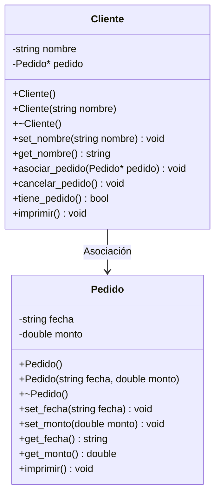

# A1 – Cliente y Pedido (asociación)

> Ejercicio 1 de la sesión 10A: *generar un Cliente que realice un Pedido con una fecha de entrega y cancele el pedido*.

## Diagrama de clase

## La relación

| | Asociación |
|---|---|
| Cómo se representa | Un atributo puntero `Pedido* pedido` dentro de `Cliente` |
| Quién crea el objeto | El `main`, no el `Cliente` |
| Quién lo destruye | El `main`, no el `Cliente` |
| Si desaparece el `Cliente` | El `Pedido` sigue existiendo |
| Cancelar el pedido | Solo pone el puntero en `nullptr`; el objeto no se borra |

## Preguntas de la sesión

| Pregunta | Respuesta |
|---|---|
| ¿Por qué el atributo es un puntero y no un objeto? | Porque los dos objetos tienen vida propia; el cliente solo *conoce* al pedido |
| ¿Qué pasa si el destructor de `Cliente` hace `delete pedido`? | Deja de ser asociación y, si el `main` también lo libera, se borra dos veces el mismo objeto |
| ¿Cómo se comprueba en la consola? | Por el orden de los mensajes de los destructores al terminar el programa |

## Tareas

- [ ] **1. Clase `Pedido`.** Crea `Pedido.h` y `Pedido.cpp` con los atributos privados `fecha` y `monto`.
- [ ] **2. Constructores y destructor de `Pedido`.** Uno vacío y uno con parámetros. El destructor imprime un mensaje con la fecha. *Pista: usa `this->` dentro del constructor.*
- [ ] **3. Setters, getters e `imprimir()`** de `Pedido`.
- [ ] **4. Clase `Cliente`.** Atributos privados `nombre` y `Pedido* pedido`. *Pista: inicia el puntero en `nullptr` en ambos constructores.*
- [ ] **5. `asociar_pedido(Pedido*)`.** Guarda el puntero que recibe. No crea nada con `new`.
- [ ] **6. `cancelar_pedido()`.** Deja el puntero en `nullptr`. *Pista: no uses `delete` aquí.*
- [ ] **7. `imprimir()` de `Cliente`.** Muestra el nombre y, si tiene pedido, sus datos; si no, un aviso. *Pista: con un puntero se accede con `->`.*
- [ ] **8. `main`.** Crea el pedido con `new`, asócialo al cliente, imprime, cancela, vuelve a imprimir y libera el pedido con `delete` al final.
- [ ] **9. Comprobación.** Observa el orden de los mensajes de los destructores y responde: ¿quién destruyó el pedido?
