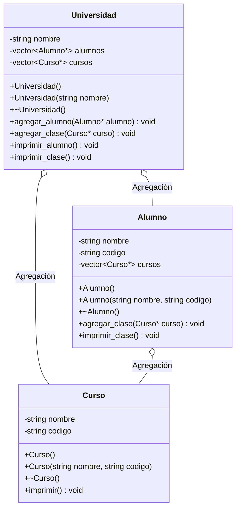

# A2 – Universidad, Alumno y Curso (agregación)

> Ejercicio 2 de la sesión 10A: *objetos de clase Alumno y Curso se agregan a Universidad. Asimismo, objetos de clase Curso se agregan a Alumno*.

> En el diagrama de la PPT el vector de la universidad aparece como `vector<Clase*>`; la clase se llama `Curso`, así que aquí se usa `vector<Curso*>` conservando los nombres de método `agregar_clase` e `imprimir_clase`.

## Diagrama de clase

## La relación

| | Agregación |
|---|---|
| Cómo se representa | Un `vector` de punteros dentro de la clase contenedora |
| Quién crea los objetos | El `main` |
| Quién los destruye | El `main` |
| Si desaparece la `Universidad` | Los alumnos y los cursos siguen existiendo |
| Un mismo `Curso` | Puede estar en la universidad y en varios alumnos a la vez, sin copiarse |

## Preguntas de la sesión

| Pregunta | Respuesta |
|---|---|
| ¿Por qué el vector guarda punteros y no objetos? | Para compartir el mismo curso entre varias listas sin duplicarlo |
| ¿Cuántas veces se destruye `CS1112` si está en dos alumnos y en la universidad? | Una sola vez, porque el objeto es uno solo |
| ¿Qué diferencia hay con la composición de A3? | Aquí las partes sobreviven al todo; en la composición, no |

## Tareas

- [ ] **1. Clase `Curso`.** Atributos privados `nombre` y `codigo`, constructores, destructor con mensaje, getters e `imprimir()`.
- [ ] **2. Clase `Alumno`.** Atributos `nombre`, `codigo` y `vector<Curso*> cursos`. *Pista: incluye `<vector>` y `Curso.h`.*
- [ ] **3. `agregar_clase(Curso*)` en `Alumno`.** Añade el puntero al vector con `push_back`.
- [ ] **4. `imprimir_clase()` en `Alumno`.** Recorre el vector y llama a `imprimir()` de cada curso. *Pista: con punteros se usa `cursos[i]->imprimir()`.*
- [ ] **5. Clase `Universidad`.** Atributos `nombre`, `vector<Alumno*>` y `vector<Curso*>`.
- [ ] **6. `agregar_alumno()` y `agregar_clase()`** en `Universidad`.
- [ ] **7. `imprimir_alumno()` e `imprimir_clase()`** en `Universidad`.
- [ ] **8. `main`.** Crea 3 cursos y 2 alumnos con `new`, agrégalos a la universidad y matricula a cada alumno en algunos cursos.
- [ ] **9. Liberación.** Libera alumnos y cursos al final con `delete`. *Pista: cada objeto se libera una sola vez, aunque aparezca en varias listas.*
- [ ] **10. Comprobación.** Cuenta los mensajes de destructor: deben ser 2 alumnos + 3 cursos + 1 universidad.
