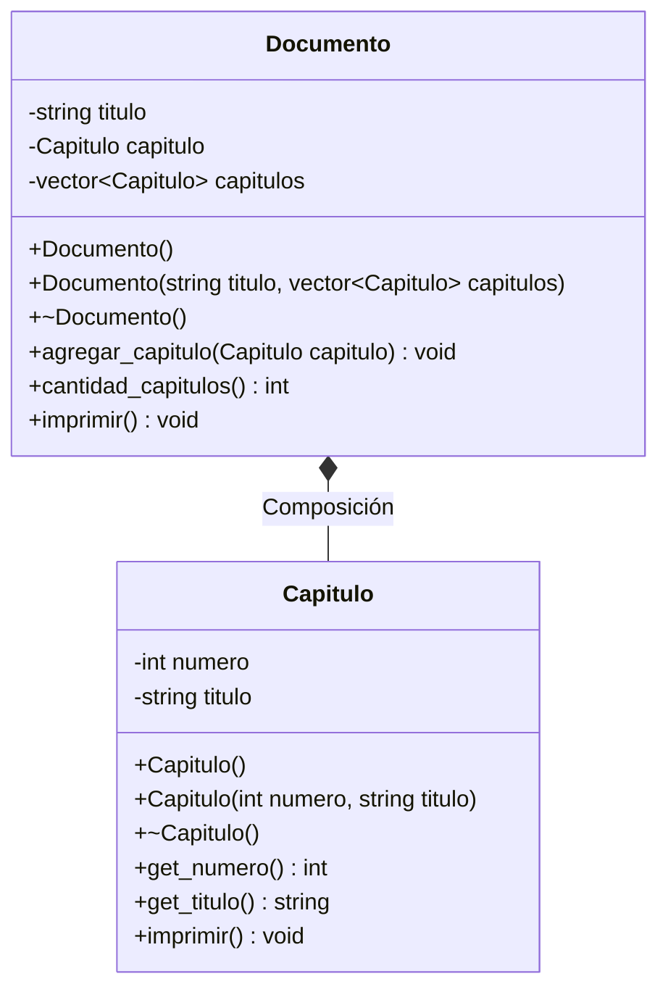

# A3 – Documento y Capítulo (composición)

> Ejercicio 3 de la sesión 10A: *generar un Documento con datos de la clase Capitulo*.

## Diagrama de clase

## La relación

| | Composición |
|---|---|
| Cómo se representa | Atributos **por valor**: `Capitulo capitulo` y `vector<Capitulo> capitulos` |
| Quién crea las partes | El propio `Documento`, al construirse |
| Quién las destruye | El `Documento`; el vector libera sus elementos automáticamente |
| Si desaparece el `Documento` | Los capítulos desaparecen con él |
| ¿Se pueden compartir? | No: cada documento tiene su propia copia |

## Preguntas de la sesión

| Pregunta | Respuesta |
|---|---|
| ¿Por qué no hace falta `delete` en el destructor? | Porque los capítulos no se crearon con `new`: viven dentro del objeto |
| ¿Qué pasa si se modifica el vector original del `main` después de construir el documento? | No cambia nada en el documento: recibió una copia |
| ¿Cuándo convendría usar `vector<Capitulo*>`? | Si los capítulos tuvieran que existir fuera del documento o compartirse (eso ya sería agregación) |

## Tareas

- [ ] **1. Clase `Capitulo`.** Atributos privados `numero` (int) y `titulo` (string), con constructor vacío y con parámetros.
- [ ] **2. Getters e `imprimir()`** de `Capitulo`.
- [ ] **3. Clase `Documento`.** Atributos `titulo`, `Capitulo capitulo` y `vector<Capitulo> capitulos`, todos por valor.
- [ ] **4. Constructor con parámetros.** Recibe `string` y `vector<Capitulo>`. *Pista: copia el vector y usa su primer elemento como capítulo inicial, validando que no esté vacío.*
- [ ] **5. Destructor.** Imprime un mensaje con el título y la cantidad de capítulos. *Pista: no lleva ningún `delete`; explica en clase por qué.*
- [ ] **6. `agregar_capitulo(Capitulo)`.** Añade un capítulo más al vector.
- [ ] **7. `cantidad_capitulos()`.** Devuelve el tamaño del vector.
- [ ] **8. `imprimir()`.** Muestra el título, el capítulo inicial y la lista completa. *Pista: aquí se accede con `.` porque son objetos, no punteros.*
- [ ] **9. `main`.** Arma un `vector<Capitulo>` con 3 capítulos, construye el documento, agrega un cuarto e imprime.
- [ ] **10. Comprobación.** Verifica que el mensaje del destructor del documento aparece una sola vez, al terminar el programa.
