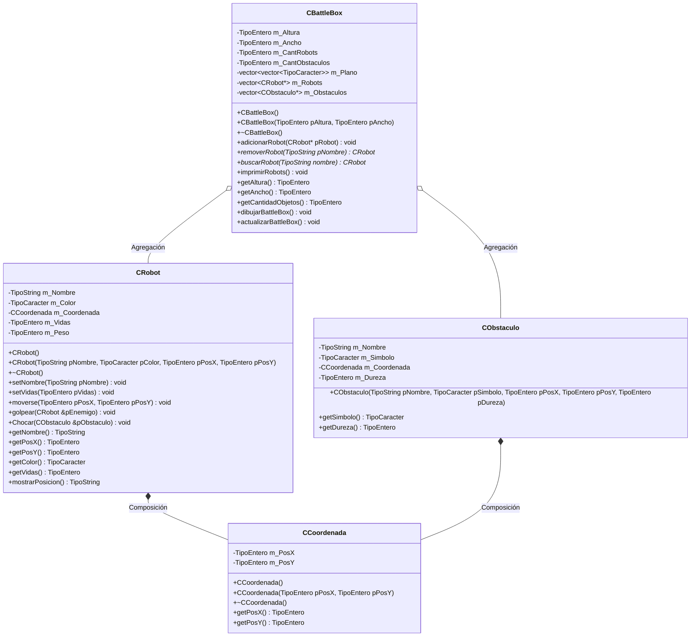

# A4 – BattleBot: golpear y CCoordenada

> Ejercicio 4 de la sesión 10A, en dos partes:
> **4.a** agregar el método `Golpear()` que recibe el objeto al que se va a golpear y le quita vidas.
> **4.b** agregar la clase `CCoordenada` y relacionarla con `CRobot`, seteando `m_PosX` y `m_PosY` **mediante el constructor de `CCoordenada`**.

> El código base de la PPT está en enlaces externos que no tenemos; aquí el proyecto se arma desde cero siguiendo el diagrama de clases de la diapositiva.

## Diagrama de clase



## Las dos relaciones juntas

| Relación | Entre | Cómo se ve en el código | Quién libera la memoria |
|---|---|---|---|
| Composición | `CRobot` ◆— `CCoordenada` | Atributo **por valor** `CCoordenada m_Coordenada`, construido en la lista de inicialización | Nadie: muere con el robot |
| Agregación | `CBattleBox` ◇— `CRobot` | `vector<CRobot*>` | El `main`, que creó los robots con `new` |

## Sobre el código de la PPT

La diapositiva muestra esta versión de `golpear`:

```cpp
void Robot::golpear(const Robot &enemigo)
{
    int averia = (peso >= 35) ? 2 : 1;
    enemigo.setVidas(enemigo.getVidas() - averia);
}
```

Tal cual **no compila**: el parámetro es `const`, y `setVidas` modifica el objeto. Por eso aquí se recibe `CRobot &pEnemigo` sin `const`. Es un buen punto para discutir en clase qué significa `const` en un parámetro por referencia.

El atributo `m_Peso` tampoco aparece en el diagrama, pero el código de la PPT lo usa, así que se agrega a `CRobot`.

## Tareas

- [ ] **1. `Tipos.h`.** Define `TipoEntero`, `TipoCaracter` y `TipoString` con `typedef`. *Pista: así el código queda igual que el diagrama.*
- [ ] **2. Clase `CCoordenada`.** Atributos privados `m_PosX` y `m_PosY`, constructor vacío, constructor con parámetros, destructor `virtual` y getters.
- [ ] **3. Clase `CRobot`.** Atributos `m_Nombre`, `m_Color`, `CCoordenada m_Coordenada`, `m_Vidas` y `m_Peso`.
- [ ] **4. Constructor de `CRobot` con lista de inicialización.** *Pista: `CRobot::CRobot(...) : m_Coordenada(pPosX, pPosY) { ... }` — así la posición se setea mediante el constructor de `CCoordenada`, como pide el ejercicio 4.b.*
- [ ] **5. `getPosX()` y `getPosY()` de `CRobot`.** Delegan en la coordenada. *Pista: `return m_Coordenada.getPosX();`*
- [ ] **6. `moverse(x, y)` y `mostrarPosicion()`.** Mover cambia la coordenada; mostrar devuelve un texto `"(x, y)"`.
- [ ] **7. `golpear(CRobot&)`.** Calcula la avería según el peso (`>= 35` quita 2, si no quita 1) y descuenta vidas al enemigo.
- [ ] **8. Clase `CObstaculo` y `Chocar()`.** El obstáculo tiene dureza; chocar le quita esas vidas al robot.
- [ ] **9. Clase `CBattleBox`.** Atributos del diagrama, incluido el plano `vector<vector<TipoCaracter>>`.
- [ ] **10. `adicionarRobot`, `buscarRobot` y `removerRobot`.** *Pista: remover saca el puntero del vector con `erase` y lo devuelve; no hace `delete`.*
- [ ] **11. `actualizarBattleBox()` y `dibujarBattleBox()`.** Limpia el plano, coloca obstáculos y robots por su coordenada y luego lo imprime. *Pista: valida que la posición esté dentro del tablero antes de escribirla.*
- [ ] **12. `main`.** Crea dos robots de pesos distintos, un obstáculo, dibuja el tablero, haz que se golpeen y que uno choque, vuelve a dibujar y libera con `delete`.
- [ ] **13. Comprobación.** ¿Por qué un robot pesado quita 2 vidas y uno liviano 1? ¿Cuántos destructores se ejecutan al final y en qué orden?
