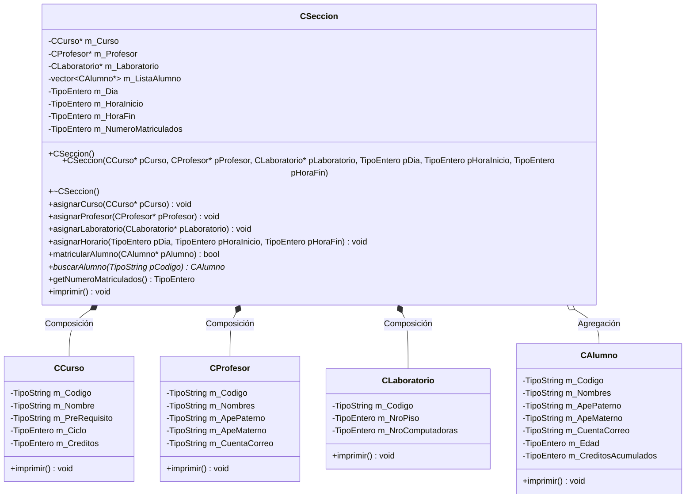

# B1 – Sistema de matrícula (sesión 10B)

> Ejercicio 1 de la sesión 10B: el departamento de Ciencias de la Computación quiere implementar un nuevo sistema de **Matrícula** en UTEC, aprovechando el *skill* de C++ de los estudiantes.

## Requerimientos de la PPT

- **Alumno:** código, nombres, apellido paterno, apellido materno, edad, cuenta de correo, créditos acumulados aprobados.
- **Profesor:** código, nombres, apellidos, cuenta de correo.
- **Curso:** código de curso, nombre, prerrequisito, ciclo, número de créditos.
- **Laboratorio:** código (ejemplo `L604`), nro de piso, capacidad de computadoras.
- **Sección:**
  - tiene asignado un curso,
  - el profesor es parte de una sección,
  - tiene asignado un laboratorio,
  - tiene **a lo más 25 alumnos** registrados,
  - tiene un horario disponible: día, hora de inicio, hora de fin.

## Diagrama de clase

## Cómo se lee el diagrama

| Relación | Rombo | Entre | Significado |
|---|---|---|---|
| Composición | ◆ relleno | `CSeccion` con `CCurso`, `CProfesor`, `CLaboratorio` | La sección no tiene sentido sin su curso, su profesor y su laboratorio |
| Agregación | ◇ vacío | `CSeccion` con `CAlumno` | Los alumnos existen independientemente: están en la sección, pero no son parte de ella |

> Aunque las tres primeras sean composición en el diagrama, los atributos son punteros (`CCurso*`, `CProfesor*`, `CLaboratorio*`). Por eso aquí los objetos se crean y se liberan en el `main`, y el destructor de `CSeccion` no hace `delete`. Discutir en clase qué habría que cambiar para que fuera composición estricta (atributos por valor, como en A3).

## Salida esperada

La salida reproduce el formato de la diapositiva: `Datos de la seccion` → datos del curso → del profesor → del laboratorio → día y horas → y luego un bloque `Alumnos matriculados` por cada alumno.

> En la captura de la PPT los campos *Día*, *Hora inicio*, *Hora fin* y *Nombres* salen vacíos. Aquí sí se imprimen con sus valores: es justamente el detalle que los alumnos deben notar y corregir.

## Tareas

- [ ] **1. `Tipos.h`.** Define `TipoEntero` y `TipoString` con `typedef`.
- [ ] **2. Clase `CAlumno`.** Los 7 atributos privados de la PPT, constructor vacío, constructor con parámetros, getters e `imprimir()`.
- [ ] **3. Clase `CProfesor`.** Código, nombres, apellidos y correo.
- [ ] **4. Clase `CCurso`.** Código, nombre, prerrequisito, ciclo y créditos.
- [ ] **5. Clase `CLaboratorio`.** Código, nro de piso y nro de computadoras.
- [ ] **6. Clase `CSeccion`.** Atributos del diagrama: tres punteros, un `vector<CAlumno*>`, día, hora inicio, hora fin y número de matriculados.
- [ ] **7. Constante `MAX_ALUMNOS = 25`.** *Pista: declárala como `static const TipoEntero` dentro de la clase.*
- [ ] **8. `asignarCurso`, `asignarProfesor`, `asignarLaboratorio` y `asignarHorario`.** Solo guardan lo que reciben.
- [ ] **9. `matricularAlumno(CAlumno*)`.** Devuelve `false` si ya hay 25 alumnos o si el código ya está matriculado; si no, lo agrega y actualiza el contador. *Pista: apóyate en `buscarAlumno`.*
- [ ] **10. `buscarAlumno(TipoString)`.** Recorre el vector comparando códigos; devuelve el puntero o `nullptr`.
- [ ] **11. `imprimir()`.** Replica el formato de la diapositiva, validando que los punteros no sean `nullptr` antes de usarlos.
- [ ] **12. Día como texto.** El día es un entero; conviértelo a nombre. *Pista: un `switch` con los valores 1 a 6.*
- [ ] **13. `main`.** Crea el curso `CS1002`, el profesor `P2017001`, el laboratorio `L604` y dos alumnos; arma la sección, matricula a los dos e imprime.
- [ ] **14. Prueba de límites.** Intenta matricular dos veces al mismo alumno y verifica el mensaje.
- [ ] **15. Liberación.** Libera con `delete` todo lo creado con `new` y comprueba que no se libera nada dos veces.
