# Ejercicios propuestos – Semana 11 (Relaciones entre clases)

Ejercicios adicionales para los alumnos que terminen antes. Solo usan lo visto en la Semana 11: **asociación, agregación y composición**, con punteros, vectores de punteros y objetos por valor (sin herencia ni polimorfismo).

| # | Ejercicio | Tipo | Tiempo aprox. |
|---|-----------|------|---------------|
| 1 | Asociación en los dos sentidos | Extensión de A1 | 10–15 min |
| 2 | Un cliente con varios pedidos | Extensión de A1 | 15 min |
| 3 | Universidad → buscar y listar | Extensión de A2 | 15–20 min |
| 4 | Documento → índice y búsqueda | Extensión de A3 | 10–15 min |
| 5 | BattleBot → batalla por turnos | Extensión de A4 | 20 min |
| 6 | BattleBot → obstáculos y colisiones | Extensión de A4 | 15–20 min |
| 7 | Matrícula → varias secciones | Extensión de B1 | 20 min |
| 8 | Matrícula → reporte de la sección | Reto | 20–25 min |

---

## 1. Asociación en los dos sentidos

**Enunciado.** Con las clases `Cliente` y `Pedido` de A1, haga que el `Pedido` también conozca a su `Cliente`: agregue el atributo `Cliente* cliente` y el método `asignar_cliente(Cliente*)`. Modifique `asociar_pedido` del cliente para que, además de guardar el pedido, le avise al pedido quién es su cliente.

En el `main` imprima desde el pedido el nombre de su cliente. Luego cancele el pedido desde el cliente y responda: ¿el pedido sigue conociendo al cliente?

**Conceptos:** asociación bidireccional, referencias cruzadas entre dos clases, declaración adelantada (`class Cliente;`) para evitar que los dos `.h` se incluyan mutuamente.

**Diagrama de clase**

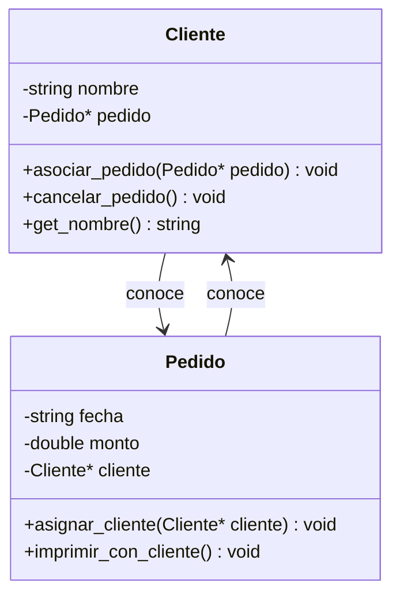

**Diagrama de flujo – programa principal**

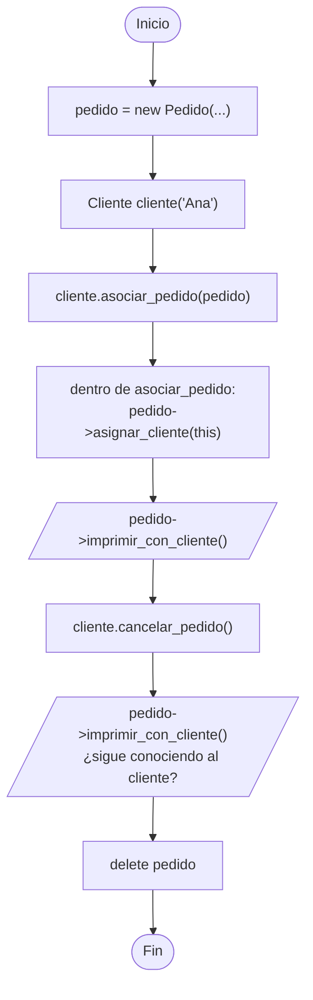

---

## 2. Un cliente con varios pedidos

**Enunciado.** Cambie el atributo `Pedido* pedido` de `Cliente` por `vector<Pedido*> pedidos`. Agregue:

- `agregar_pedido(Pedido*)`,
- `cancelar_pedido(string fecha)`: quita del vector el pedido de esa fecha (sin destruirlo),
- `monto_total()`: devuelve la suma de los montos de todos sus pedidos.

En el `main` cree tres pedidos, agrégueselos al cliente, muestre el total, cancele uno y vuelva a mostrar el total.

**Conceptos:** de un puntero simple a un vector de punteros, `erase` sobre un vector, recorrer punteros con `->`.

**Diagrama de clase**

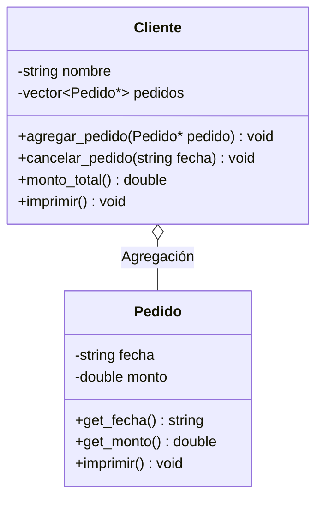

**Diagrama de flujo – `monto_total()`**

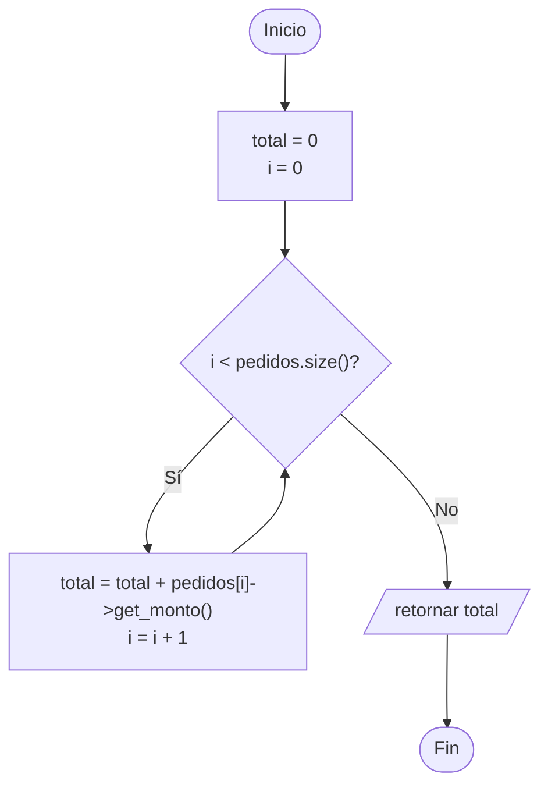

---

## 3. Universidad → buscar y listar

**Enunciado.** Con las clases de A2, agregue a `Universidad`:

- `buscar_alumno(string codigo)`: devuelve el puntero al alumno o `nullptr`,
- `alumnos_del_curso(string codigo_curso)`: imprime los alumnos que llevan ese curso,
- `alumno_con_mas_cursos()`: devuelve el puntero al alumno matriculado en más cursos.

Para los dos últimos necesitará consultar los cursos de cada alumno: agregue a `Alumno` el método `lleva_curso(string codigo)` y `cantidad_cursos()`.

**Conceptos:** recorrer dos niveles de agregación (universidad → alumno → curso), búsqueda devolviendo punteros, comparar para hallar el máximo.

**Diagrama de clase**

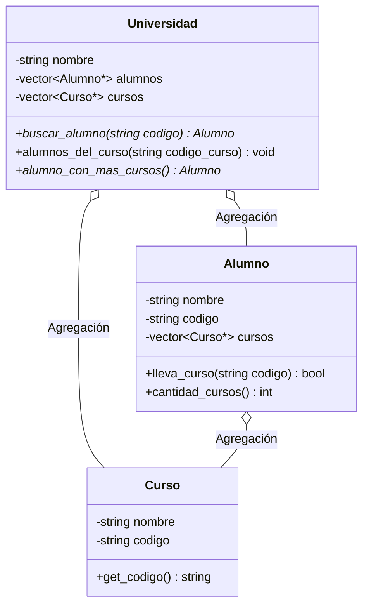

**Diagrama de flujo – `alumnos_del_curso(codigo_curso)`**

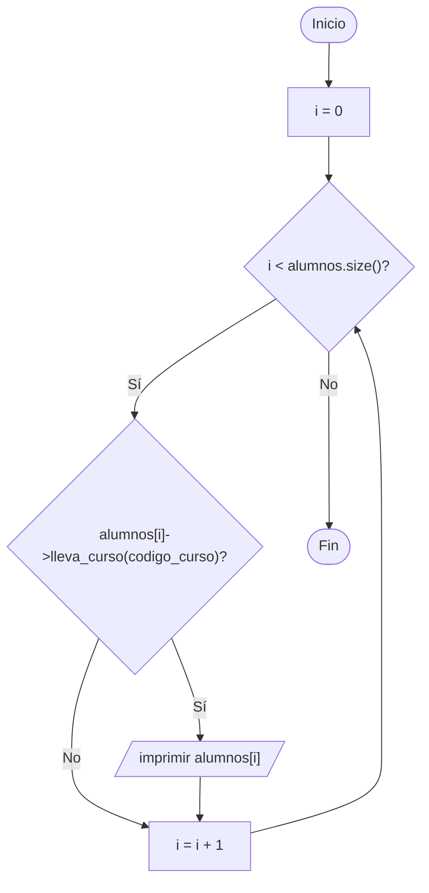

---

## 4. Documento → índice y búsqueda

**Enunciado.** Con las clases de A3, agregue a `Documento`:

- `imprimir_indice()`: muestra solo número y título de cada capítulo, en una línea por capítulo,
- `buscar_capitulo(int numero)`: devuelve el título del capítulo con ese número, o `"no existe"`,
- `renumerar()`: vuelve a numerar los capítulos de 1 a N según el orden del vector.

Pruebe agregando capítulos desordenados y llamando a `renumerar()`.

**Conceptos:** recorrer un vector de objetos **por valor** (se accede con `.`), modificar los elementos en su sitio, diferencia con el recorrido de punteros de los ejercicios anteriores.

**Diagrama de clase**

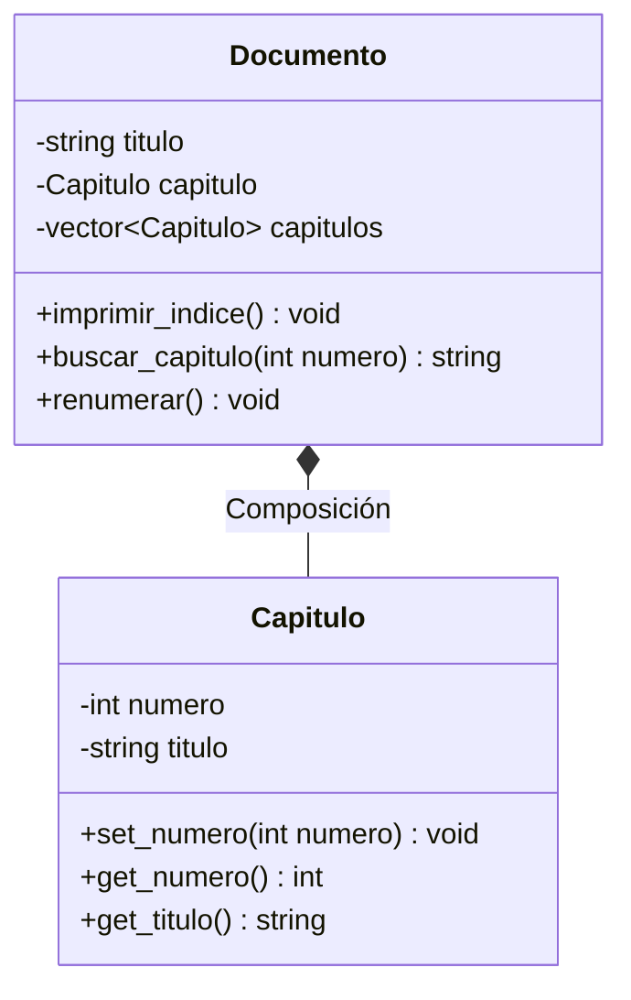

**Diagrama de flujo – `renumerar()`**

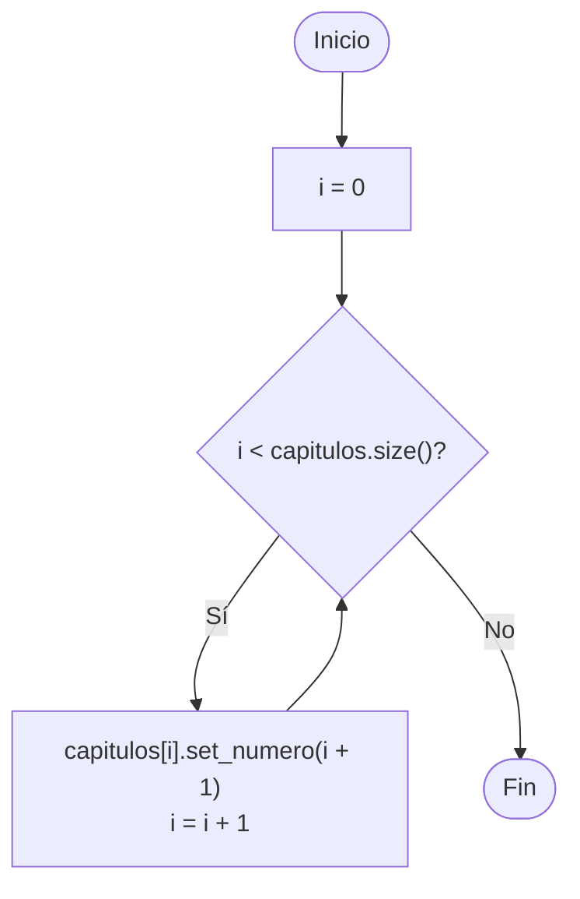

---

## 5. BattleBot → batalla por turnos

**Enunciado.** Con las clases de A4, agregue a `CBattleBox` el método `batalla()`: mientras queden al menos dos robots con vidas, en cada turno un robot golpea al siguiente de la lista. Cuando un robot llega a **0 vidas** se retira del tablero con `removerRobot()` y se avisa en pantalla. El método termina cuando queda un solo robot en pie y anuncia al ganador.

Imprima el tablero al inicio y al final de la batalla.

**Conceptos:** recorrer un vector de punteros modificándolo durante el recorrido, usar `golpear()` entre objetos de la misma clase, condición de fin de un bucle.

**Diagrama de clase**

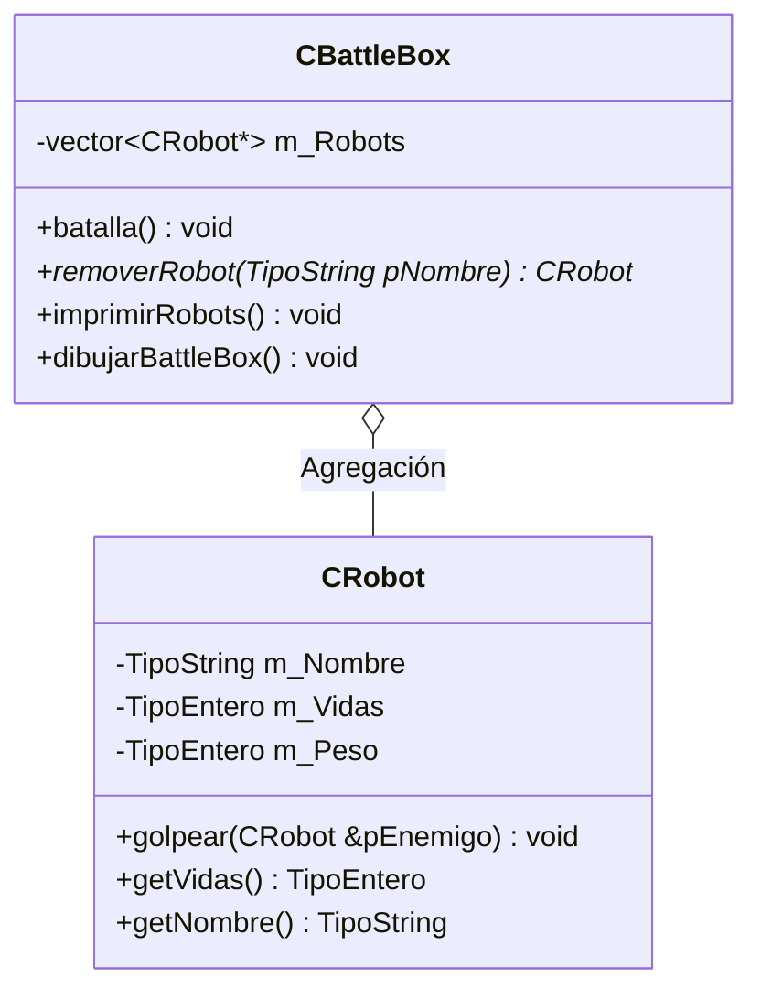

**Diagrama de flujo – `batalla()`**

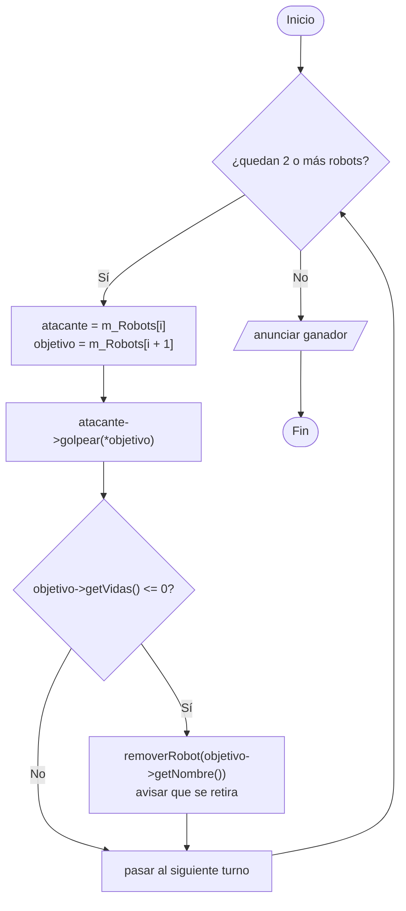

---

## 6. BattleBot → obstáculos y colisiones

**Enunciado.** Agregue a `CBattleBox` el método `moverRobot(string nombre, int x, int y)` que:

- busca el robot con `buscarRobot()`,
- valida que `(x, y)` esté dentro del tablero,
- si en esa casilla hay un obstáculo, llama a `Chocar()` y **no** mueve al robot,
- si está libre, llama a `moverse()`.

Agregue también `hayObstaculo(int x, int y)` que recorra el vector de obstáculos y devuelva `true` o `false`.

**Conceptos:** combinar las dos agregaciones del tablero, validar límites antes de modificar el estado, delegar en los métodos que ya existen.

**Diagrama de clase**

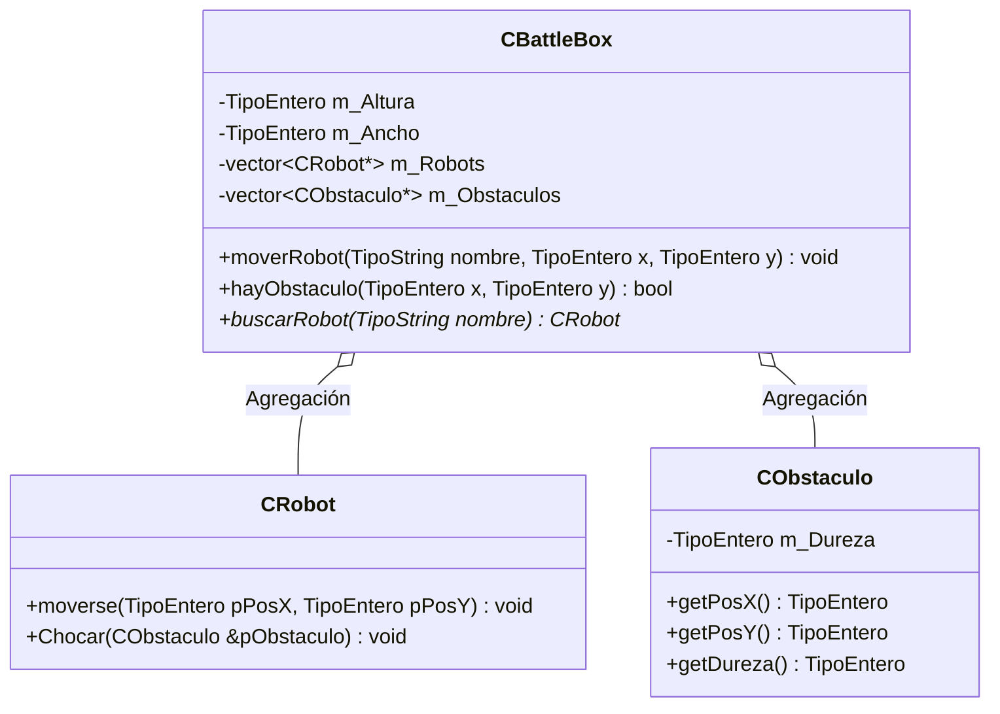

**Diagrama de flujo – `moverRobot(nombre, x, y)`**

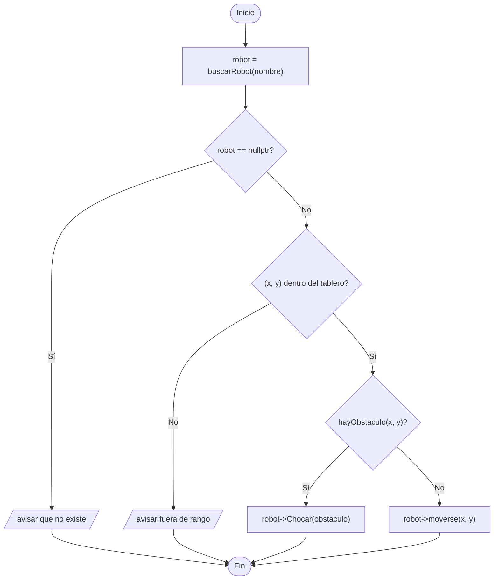

---

## 7. Matrícula → varias secciones

**Enunciado.** Cree la clase `CHorario` que agrupe `m_Dia`, `m_HoraInicio` y `m_HoraFin`, y úsela **por composición** dentro de `CSeccion` (reemplazando los tres atributos sueltos). Luego cree una clase `CCiclo` que agregue varias secciones (`vector<CSeccion*>`) y ofrezca:

- `agregar_seccion(CSeccion*)`,
- `imprimir_secciones()`,
- `total_matriculados()`: la suma de los matriculados de todas sus secciones.

**Conceptos:** extraer atributos relacionados a una clase propia, composición dentro de una clase que ya tiene agregación, un nivel más de contenedores.

**Diagrama de clase**

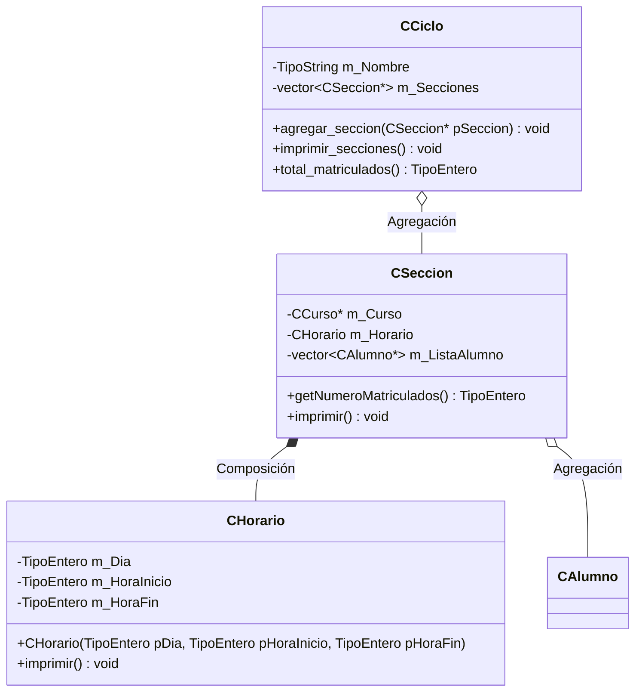

**Diagrama de flujo – `total_matriculados()`**

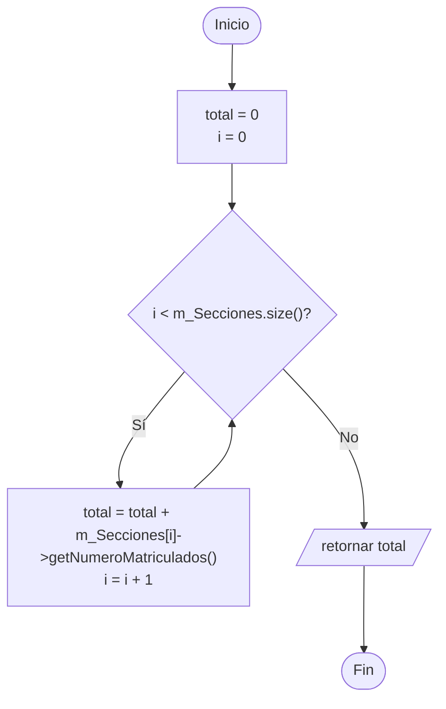

---

## 8. Matrícula → reporte de la sección (reto)

**Enunciado.** Agregue a `CSeccion` un reporte con:

- `vacantes_disponibles()`: `MAX_ALUMNOS` menos los matriculados,
- `promedio_creditos()`: promedio de créditos acumulados de los alumnos de la sección,
- `alumno_con_mas_creditos()`: devuelve el puntero al alumno con más créditos acumulados,
- `retirarAlumno(string codigo)`: saca al alumno del vector (sin destruirlo), devuelve su puntero y actualiza el contador,
- `cabe_en_laboratorio()`: `true` si el número de matriculados no supera la capacidad de computadoras del laboratorio.

Muestre el reporte completo, retire un alumno y vuelva a mostrarlo.

**Conceptos:** cálculos sobre un vector de punteros, división protegida contra el caso de lista vacía, mantener coherente el contador al modificar la lista, consultar un objeto compuesto (`m_Laboratorio`) desde el todo.

**Diagrama de clase**

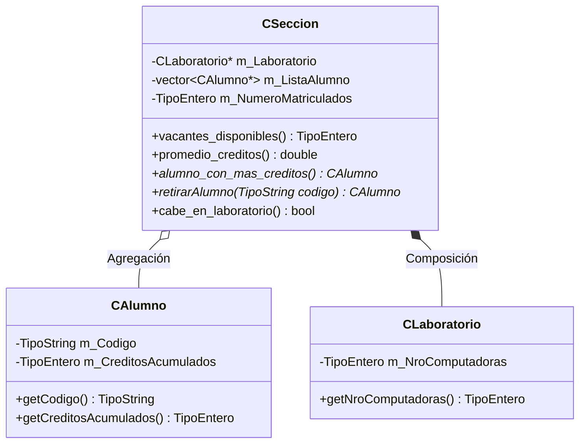

**Diagrama de flujo – `promedio_creditos()`**

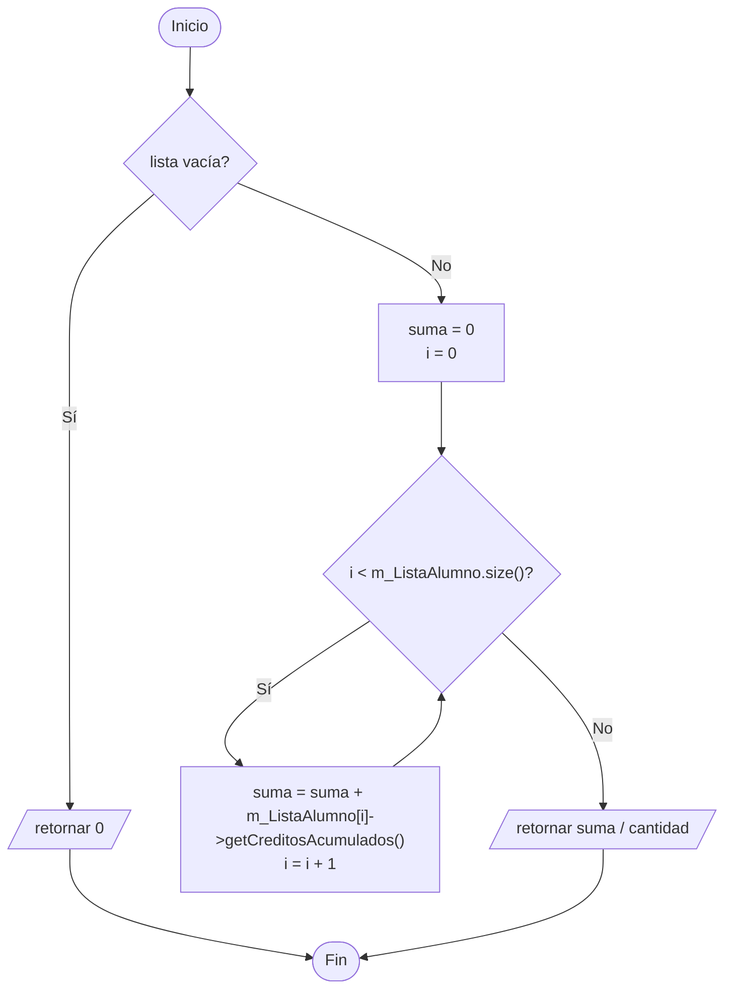
