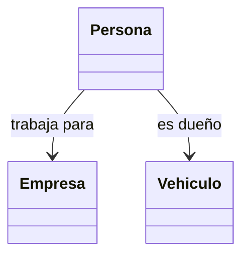

# PO_UTEC – Semana 11 (Relaciones entre clases)

Laboratorio de **Programación II (CS6003)**, Unidad 6: *Relaciones entre clases*. Resumen de la teoría de la sesión 10 (**asociación, agregación y composición**) y de dónde se usa cada una en los ejercicios.

## Ejercicios del laboratorio

| Carpeta | Ejercicio | Relación que usa |
|---------|-----------|------------------|
| `A1_ClientePedido` | Cliente que realiza y cancela un pedido | asociación (`Pedido*`) |
| `A2_Universidad` | Universidad, Alumno y Curso | agregación (`vector<Alumno*>`, `vector<Curso*>`) |
| `A3_DocumentoCapitulo` | Documento con sus capítulos | composición (`vector<Capitulo>` por valor) |
| `A4_BattleBot` | BattleBox, Robot y Coordenada | composición (`CCoordenada`) + agregación (`vector<CRobot*>`) |
| `B1_Matricula` | Sistema de matrícula UTEC | composición y agregación en una misma clase |

Ejercicios adicionales: [EJERCICIOS_PROPUESTOS.md](EJERCICIOS_PROPUESTOS.md)

---

## 1. ¿Qué es una relación entre clases?

Hasta la semana anterior cada clase vivía sola. En un programa real los objetos se conocen entre sí: una persona **tiene** hijos, **trabaja para** una empresa, **posee** un vehículo, **dirige** un área. Esos verbos son las relaciones.



Los cuatro tipos que se ven en el curso son **asociación, agregación, composición y herencia**. Esta sesión cubre las tres primeras.

---

## 2. Asociación

Una clase **conoce** a otra, pero ninguna es parte de la otra ni se encarga de su memoria.

```cpp
class Cliente {
private:
    string nombre;
    Pedido* pedido;      // solo lo conoce
public:
    void asociar_pedido(Pedido* p) { pedido = p; }
    void cancelar_pedido()         { pedido = nullptr; }  // no hace delete
};
```

- Se implementa con un **puntero** al otro objeto.
- Quien crea el objeto con `new` es quien lo libera con `delete`.
- Romper la relación es poner el puntero en `nullptr`: el otro objeto sigue vivo.

**Se usa en:** A1.

---

## 3. Agregación

Relación **"tiene un"** débil: el todo contiene partes, pero las partes **existen por sí solas** y pueden compartirse.

```cpp
class Universidad {
private:
    vector<Alumno*> alumnos;   // los alumnos existen fuera de la universidad
public:
    void agregar_alumno(Alumno* a) { alumnos.push_back(a); }
};
```

- Se implementa con un **vector (o arreglo) de punteros**.
- Un mismo objeto puede estar en varias listas sin copiarse: `CS1112` puede estar en la universidad y en dos alumnos a la vez.
- El destructor del contenedor **no** libera las partes.
- En UML se dibuja con un **rombo vacío** ◇ del lado del todo.

**Se usa en:** A2, A4 (`CBattleBox` con sus robots) y B1 (`CSeccion` con sus alumnos).

---

## 4. Composición

Relación **"es parte de"** fuerte: la parte **nace y muere con el todo**.

```cpp
class Documento {
private:
    vector<Capitulo> capitulos;   // por valor: viven dentro del documento
};

class CRobot {
private:
    CCoordenada m_Coordenada;     // por valor: nace con el robot
public:
    CRobot(string n, int x, int y) : m_Coordenada(x, y) { nombre = n; }
};
```

- Se implementa con atributos **por valor**, no con punteros.
- La parte se construye en la **lista de inicialización** del constructor.
- No hace falta `delete`: la memoria se libera sola al destruirse el objeto contenedor.
- No se puede compartir: cada todo tiene su propia parte.
- En UML se dibuja con un **rombo relleno** ◆ del lado del todo.

**Se usa en:** A3, A4 (`CRobot` con `CCoordenada`) y B1 (`CSeccion` con curso, profesor y laboratorio).

---

## 5. Cómo distinguirlas

| | Asociación | Agregación | Composición |
|---|---|---|---|
| Pregunta clave | ¿Se conocen? | ¿Lo tiene, pero existe aparte? | ¿Es parte de él? |
| Atributo | Puntero | Vector o arreglo de punteros | Objeto por valor |
| ¿Quién libera? | Quien hizo el `new` | Quien hizo el `new` | Nadie: muere con el todo |
| ¿Se comparte? | Sí | Sí | No |
| Símbolo UML | línea con flecha | rombo vacío ◇ | rombo relleno ◆ |
| Ejemplo | Cliente – Pedido | Universidad – Alumno | Documento – Capítulo |

La prueba práctica: **si destruyo el todo, ¿la parte debería desaparecer?** Si la respuesta es sí, es composición; si no, es agregación o asociación.

---

## 6. Errores frecuentes

- Hacer `delete` del objeto asociado en el destructor **y** también en el `main`: el mismo objeto se libera dos veces y el programa se cae.
- Usar `.` donde va `->`: con punteros siempre `->`, con objetos por valor siempre `.`.
- Olvidar el `nullptr` inicial en un puntero de asociación, y luego usarlo sin validar.
- Setear una parte compuesta dentro del cuerpo del constructor en vez de la lista de inicialización (el ejercicio 4.b pide expresamente que la posición se setee **mediante el constructor de `CCoordenada`**).

## Compilación

Cada carpeta es un proyecto CMake independiente (CLion). Ejecute siempre desde el botón ▶ del target del proyecto.
